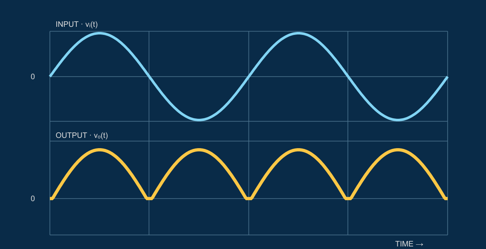

# Circuits, made visible

An interactive circuits and electronics teaching presentation for the IEEE Zewail City Student Branch Education Team.

[**Open the presentation**](https://eslammohamed202220-beep.github.io/ieee-zc-circuits-education/) · [**View the source**](https://github.com/eslammohamed202220-beep/ieee-zc-circuits-education)



## What is inside

- 32 slides covering 15 circuit topics, with 30 worked problems in 15 practice slides and a 14-question concept check.
- Animated current paths and waveform diagrams for diode circuits, rectifiers, filters, clippers, clampers, and a voltage multiplier.
- Revealable problem solutions, circuit state controls, keyboard navigation, and a topic index.

See [COURSE.md](COURSE.md) for the topic order and the approximations used in the examples.

## How it works

The deck is a static HTML, CSS, and JavaScript site. `course-content.js` holds the explanations and problems. `course-visuals.js` draws and animates the circuit and waveform diagrams, while `course-ui.js` handles slide navigation and interactive controls. The logo and fonts are bundled locally; the published site does not require external runtime services.

## Run locally

With Node.js installed, run:

```bash
npm run dev
```

Then open [http://localhost:4176/](http://localhost:4176/). There are no npm dependencies to install.

## Attribution

The explanations and exercises are based on five lecture PDFs supplied for this teaching session. The PDFs are not included in this repository. The IEEE Zewail City Student Branch mark is used for this branch presentation. Barlow Condensed and IBM Plex fonts are redistributed under the SIL Open Font License; their license texts are in `fonts/licenses/`. No license is granted here for reusing this project's code or the IEEE mark.
